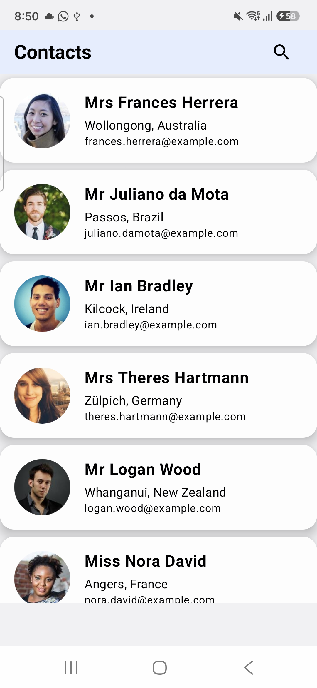

# Lydia - Contact List & Detail App

**Lydia** is a modern Android application built with **Jetpack Compose**, **Kotlin**, and **Paging 3**, designed for browsing, searching, and interacting with contacts, while providing a rich and smooth user experience with offline support and animations.

The app uses the **RandomUser API v1.3** ([https://randomuser.me/](https://randomuser.me/)) to fetch user data.

---

## Table of Contents

- [Features](#features)
- [API](#api)
- [Architecture](#architecture)
- [Technologies](#technologies)
- [Setup](#setup)
- [Usage](#usage)
- [Project Structure](#project-structure)
- [Animations & UX](#animations--ux)
- [Tests](#tests)
- [Screenshots](#screenshots)
- [Future Improvements](#future-improvements)

---

## Features

- **Paginated contact list** using **Paging 3**, with local caching in **Room**.
- **Offline support**: previously loaded contacts remain accessible without a network connection.
- **Local search**: filter contacts without triggering network requests.
- **Contact details screen**:
  - Avatar, full name, username, age, email, phone, city, country, registration date.
  - Swipe between contacts horizontally using a **pager**.
  - Animated transitions between contacts.
- **Interactive actions**:
  - Directly call or email a contact.
  - Share contact information via Android’s sharing intents.
- **Dynamic network handling**:
  - Automatic refresh when returning online.
  - Offline banner indicating current connection state.
- **Animations & placeholders**:
  - Shimmering skeleton cards while the first page loads, Lottie animations for the empty and error screens.
  - Pull-to-refresh on the list.
  - Smooth fade and scale animations for avatar and info cards on detail screens.
- **Light and dark themes** with a brand colour scheme.

---

## API

- The app fetches contacts from the **RandomUser API v1.3**.
- Endpoints used:
  - `https://randomuser.me/api/?page=<page>&results=<pageSize>`
- Data retrieved includes **UUID, name, gender, email, phone, avatar, location, age, username, and registration date**.
- Responses are cached locally in **Room**, with **RemoteMediator** ensuring pagination and offline support.

---

## Architecture

- **MVVM** architecture combined with **Clean Architecture** principles.
- Layers:
  - **Data**: handles API calls, Room database, and RemoteMediator.
  - **Domain**: contains business logic and use cases.
  - **UI**: Jetpack Compose screens and components.
- **Dependency Injection**: Hilt.
- **Asynchronous Flow**: Kotlin **Flow**.

---

## Technologies

- Kotlin
- Jetpack Compose
- Paging 3
- Room
- Retrofit
- Hilt
- Lottie (animations)
- Coil (image loading)
- Kotlin Coroutines & Flow
- Android Navigation Compose

---

## Setup

1. Clone the repository:
```bash
git clone <repo-url>
```

2. Open in **Android Studio**.
3. The project uses **Kotlin 2.1**, **AGP 8.12** and the **Compose BOM 2025.08** (JDK 17+ to run Gradle).
4. Build the project.
5. Run the app on an emulator or device.

---

## Usage

- Browse the contact list.
- Search locally by name using the search bar.
- Tap a contact to view details.
- Swipe horizontally to navigate between contacts.
- Call, email, or share contact info directly from the detail screen.
- Offline banner indicates connection status, and contacts remain accessible.

---

## Project Structure

```
com.kev.lydia
 ├─ data
 │   ├─ api
 │   ├─ datasource
 │   └─ mapper
 ├─ domain
 │   └─ usecase
 └─ ui
     ├─ list
     ├─ details
     └─ components
```

- **data**: API services, Room database, DTOs, mappers.
- **domain**: business logic and use cases.
- **ui**: Compose screens, components, top bars, pagers.

---

## Animations & UX

- Skeleton placeholders while loading, Lottie animations for the empty and error states.
- Smooth scaling and fading of avatars in detail screen.
- Swiping between contacts with animated transitions.
- Dynamic background gradients and info card animations.

---

## Tests

```bash
./gradlew :app:testDebugUnitTest   # JVM unit tests (ViewModels, search, mediator errors, UI state helpers)
./gradlew :data:testDebugUnitTest :domain:testDebugUnitTest   # Robolectric tests (Room DAOs, mapper, mediator)
```

---

## Screenshots

<p align="center">
  
</p>


---

## Future Improvements

- Add favorites functionality.
- Compose UI tests for the list and detail screens.
- Shared element transition of the avatar between the list and the detail (needs Navigation Compose 2.7+).
